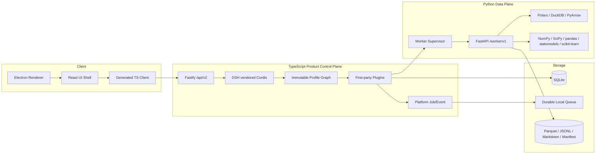

# ZhiYun 1.0 当前架构

本文描述当前 Electron 本地产品架构。应用入口已收敛为 `desktop`、`portal`、`admin`、`server`，见 [ADR 0011](adr/0011-desktop-cloud-apps.md)；独立商业服务见 [云端商业架构](architecture/ZHIYUN_CLOUD_COMMERCIAL_ARCHITECTURE.md)。详细设计、技术选型和非目标见 [ZHIYUN_LEVEL2_TS_PYTHON_REFACTOR.md](./architecture/ZHIYUN_LEVEL2_TS_PYTHON_REFACTOR.md)，唯一 owner 清单由 [Architecture Catalog](./generated/architecture-catalog.json) 生成并在 CI 检查 drift。

## 1. 架构形态



架构是 Local-first 模块化单体，不是微服务集合。Worker 与 Runtime 同机，由 Electron Host 监督；Worker 失败不阻止 Collection、Dataset 和 Outputs。

## 2. Cordis 与 Profile

Runtime 与 Renderer 分别创建独立的 DSH Cordis Context。版本来自固定提交的 `desktop/tooling/dependencies/vendor/deepseek-harness/vendor`；仅将 cosmokit、schemastery、cordis、loader、include、group、timer 和 logger-console 加入 workspace。主仓库构建运行产物和声明，不修改子模块源码。实现决策见 [ADR 0012](adr/0012-dsh-cordis-plugins.md)。

`@zhiyun/plugin-runtime` 负责启动审计和宿主适配，静态 catalog 保留所有权检查；服务提供、依赖等待、插件激活和资源释放直接由 Cordis 负责。业务插件通过 `apply(ctx, config)` 注册服务、路由和 Job Handler，通过 `inject` 消费公开服务契约，通过 Schemastery 校验配置。注册的 disposer、后台循环和资源关闭属于 `ctx.effect()`。`@zhiyun/runtime-contracts` 提供宿主契约和分阶段后台生命周期事件。

Profile 使用 `cordis.yml`，Bundle 使用 `cordis.patch.yml`。Runtime Include 与离线目录生成共同使用 DSH 的 YAML schema 和 `applyEntryPatches()`，包括整项替换 config 的语义。生产只能解析 builtin 映射中的 `cordis:` 模块；配置只读，不写回安装目录。

```text
配置预检 → Include 装配及迁移 → loader.await() → ACTIVE 状态审计
→ 路由/OpenAPI 校验 → 恢复任务 → 启动后台循环 → 监听并报告 ready
关闭：停止产生任务 → 等待执行中的任务 → 释放插件树和底层资源
```

业务 profile 保留 `desktop-studio`、`safe`、`test`、`e2e`、`identity-test`。timer、logger 和宿主资源提供者为内部基础设施，不进入公开业务插件列表。Profile 变化要求重启 Runtime，`buildLevel2Runtime()` 的注入适配器调用接口和数据库迁移标识保持兼容。

UI 壳使用同一配置生成的纯数据客户端清单，通过独立 Loader 装配业务插件的 `/client` 入口。路由、导航和面板注册在 `@zhiyun/ui-sdk` 的 slots 服务中，插件释放时撤销注册。页面留在业务插件内，共享组件与客户端契约位于 ui-sdk。Runtime 重启会撤销请求、清空缓存、释放旧 Context 并重建客户端插件树。

Renderer 的 Loader 构建适配记录于 `desktop/tooling/dependencies/cordis/browser-adapter.json`。构建时验证 vendor 提交及源文件哈希，移除 Node 内部模块探测和表达式求值；主进程侧保留 DSH 的表达式机制。Electron sandbox 和原有 CSP 保持启用。

## 3. Plugin 所有权

```text
platform
└── datasets
    └── collection
        ├── outputs
        ├── preferences
        └── ai-assistance
    ├── analytics
    └── corpus
```

每个 Route、operationId、表、Migration、Event、Job Handler 和 UI Contribution 只有一个 owner。Plugin 不导入其他 Plugin 的 persistence/HTTP 实现，也不跨域直接查询数据库；跨域协作通过 Contract port、持久事件或组合层编排。

`buildLevel2Runtime()` 只完成 Repository/Capability 装配、Handler 注册和 Gateway 初始化。旧全局 Repository、LocalScheduler、SQLite global storage 与 Drizzle migration chain 已从工作区删除。

## 4. Product API 与 Client

- Product API：`/api/v2`
- Worker Protocol：`/worker/v1`
- `/api/v1`：RFC 7807 404
- Mutation：`Idempotency-Key`
- 可更新资源：`ETag` / `If-Match`
- 列表：cursor
- 持久 Domain Event 与 realtime progress 使用独立 SSE/cursor

Runtime 发布的 OpenAPI 由活动 Profile 的 Route Contribution 过滤；Gateway 启动时进行双向校验，禁止未登记路由或无实现贡献。`@zhiyun/client` 与 Worker Client 均由 OpenAPI 生成并执行 drift check。

Runtime generation 改变时 Client 中止旧请求、清空 ETag/Query cache、关闭 SSE，并重新协商 metadata、Graph 与 UI Contribution。

## 5. 数据、Job 与 Event

Desktop 的平台表和各领域表持久化到本机 SQLite。Platform Job 支持资源类、lease、heartbeat、取消、重试、恢复与确定性关闭：

```text
queued → claimed → running → persisting → succeeded
queued/running → canceling → canceled
claimed/running/persisting → interrupted → queued|failed
```

Desktop heavy 并发为 1。采集成功由 Dataset Plugin 幂等提交，再由组合层创建 Outputs delivery Job。Worker/Browser crash 可重试一次；验证、参数、资源限制和用户取消不重试。

Domain Event 与领域状态同事务提交。Durable dispatcher 使用 checkpoint、退避与 dead letter；临时进度不进入 durable cursor。

## 6. Dataset、Analytics 与 Corpus

Analytics/Corpus 只消费不可变 Dataset Snapshot：

```text
consistent SQL read
→ streaming NDJSON workspace
→ Worker type inference/normalization
→ Parquet + Schema Manifest + SHA-256 fingerprint
→ immutable Artifact
```

TypeScript 不把百万行 Snapshot 一次性载入内存。相同 fingerprint 复用已有 Snapshot。Worker 请求只包含 Job ID 和相对 Artifact Ref，所有路径必须 realpath 到对应 Job Workspace 内。

分析结果是结构化 summary/metrics/table/series/artifact；Worker 不返回 ECharts option 或可执行脚本。UI 最多直接渲染 1 万点，超限由 Worker 聚合或下采样。抽样、随机种子、方法/Worker 版本和 Snapshot provenance 都进入 Result。

Corpus Version 由 Snapshot fingerprint + Recipe revision 确定，输出 `manifest.json`、`documents.parquet`、`chunks.parquet`、`corpus.jsonl` 与可选 Markdown。1.0 不包含 Embedding 或 Vector Index。

## 7. 安全边界

- Renderer：sandbox、context isolation、无 Node/数据库/Python/凭据访问。
- Worker：默认无外网、不访问业务数据库、不持有产品凭据。
- Worker bootstrap：token、generation、workspace root 经私有 stdin；端口 ready 信息经单行 stdout JSON。
- Artifact/Workspace：只接受相对引用并进行 realpath containment 校验。
- Crawl：初始 URL、重定向、Browser 子请求均执行 SSRF/Metadata/私网策略。
- Desktop secret：Host `safeStorage`；内部运行时测试使用隔离的 AES-256-GCM 凭据存储。
- 日志与 RFC 7807 instance 对 token、Authorization、Cookie、连接串凭据脱敏。
- 1.0 不暴露任意 SQL、Python、Patsy formula、表达式或任意前端配置执行接口。

## 8. 启动、关闭与发布

Desktop 启动：

```text
Host Capability Server → Analytics Worker Supervisor
→ Core Runtime Supervisor → Renderer
```

关闭：

```text
拒绝新 mutation → 停止 claim → 取消/等待 Worker Job
→ Core Runtime → Worker → Host Capability Server
```

Desktop 发布 macOS arm64/x64 与 Windows x64，Worker 和 Chromium 位于 ASAR 外并纳入签名/公证。旧 Headless tar/image 和浏览器工作台已停止构建与发布；云端容器仅服务商业平台，不执行桌面工具。每个数据目录运行一个 Runtime，本地队列的作业、租约和幂等记录保存在 SQLite，内存只负责调度。迁移决策见 [SQLite 统一存储](adr/0010-unified-sqlite.md)。

## 9. 可观测性与供应链

Gateway 为请求创建 OpenTelemetry Server Span，接受 W3C `traceparent` 并在 Product API、RFC 7807 和日志中关联 `traceId`。Runtime diagnostics 暴露 Graph、Job、Event、Browser 与 Worker 状态；Worker Supervisor 保留 generation、PID、版本、重启次数和最近 degraded 原因，但不暴露私有 token。

PR 检查依赖边界、Catalog、Product/Worker OpenAPI、生成 Client 和测试漂移。Release workflow 生成 SBOM、Node/Python license inventory、checksum 与目标平台产物；构建期安全例外必须在 `docs/security` 中记录影响范围、原因和移除条件。打包烟测直接启动发布目录中的 Electron、Chromium 和 PyInstaller Worker，执行 Crawl → Snapshot → Analysis，而不是只检查资源是否存在。

## 10. 产品体验的组合契约

Collection 是统一创建草稿的唯一事实来源，AI Assistance 经运行时注入的受限契约读写，不直接依赖 Collection 业务实现。Datasets 的来源任务名和质量状态由组合层批量获取，版本字段取不可变 manifest；查询与导出共享同一受控 AND 筛选模型。Platform 管理持久化工作区标识及仅本地的匿名体验事件，服务端确认运行、分析、导出、同步结果。

新增迁移为增量执行；旧页面、任务、会话和规则历史保留。完整流程和接口约定参见 `docs/product/`。Desktop Artifact 保存沿受保护文件根目录解析相对键，可保存分析和语料的分层文件，并拒绝越界或符号链接。
